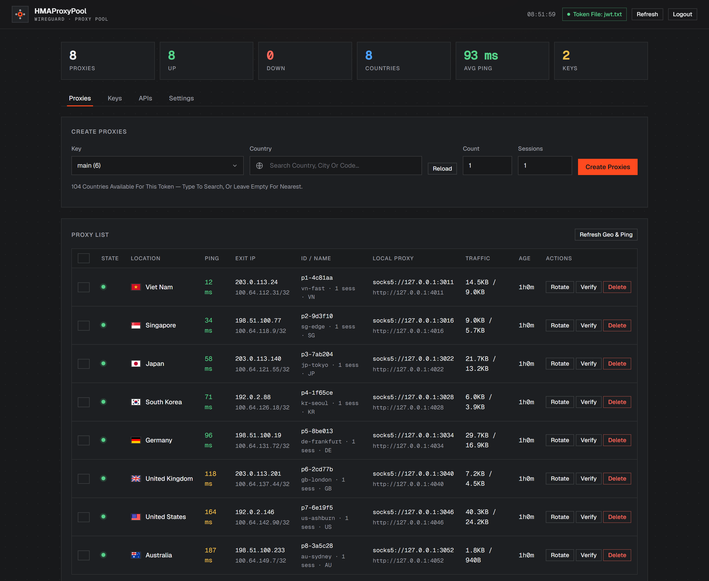
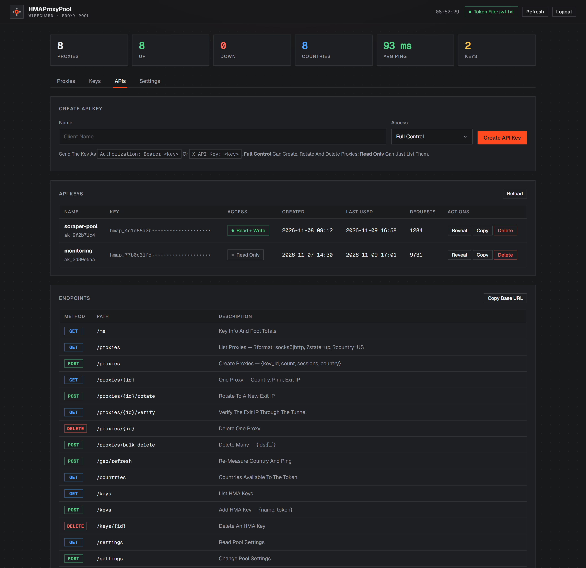

# HMAProxyPool

A self-hosted web dashboard for the HMA WireGuard proxy pool (`hgproxy` core).
One binary, no HMA client, no driver, no admin at runtime. Runs on **Windows and
Linux**; the dashboard auto-opens in your browser on start.

- **Login** — password-protected control panel (bcrypt + session cookie).
- **Dashboard** — live proxy list: state, SOCKS5/HTTP endpoints, exit IP,
  traffic, session age; totals (proxies / up / down / keys).
- **Export** — one click copies or downloads the whole list as
  `socks5://…` / `http://…` lines, rewritten to the host your clients dial
  (the dashboard host by default, or any address you type). No more copying
  ports one by one.
- **Settings** — paste your **HMA key (JWT)** or point at a watched token file;
  ports, sessions-per-proxy, probe URL. **Nothing is hardcoded.**
- **Pool** — create N proxies per key, rotate / verify / delete live; the pool
  (keys + desired sizes) is saved to `pool.json` and **auto-restored on boot**.
- **APIs** — mint bearer keys (read-only or full control) and call `/api/v1/*`
  from any program. See [API.md](API.md).



<sub>Generated from `web/index.html` by `node tools/preview/render.js` — demo
data only, no live pool and no real addresses.</sub>

## Quick start

```
build.bat        (Windows)   or   ./build.sh   (Linux)
hmaproxypool.exe            /   ./hmaproxypool
```

Cross-compile for a release (path-free binaries, no debug info):

```bash
go build -trimpath -ldflags "-s -w" -o hmaproxypool.exe .
GOOS=linux GOARCH=amd64 go build -trimpath -ldflags "-s -w" -o hmaproxypool-linux-amd64 .
GOOS=linux GOARCH=arm64 go build -trimpath -ldflags "-s -w" -o hmaproxypool-linux-arm64 .
```

## Releases

Release artifacts are produced by [`.github/workflows/release.yml`](.github/workflows/release.yml)
— nothing is built on a developer machine and uploaded by hand. Run
**Actions → release → Run workflow** with an existing tag:

```bash
git tag v1.0.0 && git push origin v1.0.0
```

- **Default (source-only)** — publishes the tag archive plus `SHA256SUMS.txt`.
  No `.exe` is uploaded.
- **`attach_binaries = true`** — additionally compiles `hmaproxypool.exe`,
  `hmaproxypool-linux-amd64`, `hmaproxypool-linux-arm64` from the tagged
  source inside the runner, checks the binaries for leaked build paths, and
  publishes them with checksums.

`hmatoken.exe` is **deliberately not published**: it reads another process'
memory, which antivirus engines classify as a credential-stealer heuristic and
which gets accounts flagged. Build it yourself if you need live token import:

```bash
go build -o hmatoken.exe ./tools/hmatoken     # Windows, elevated to run
```

Every binary is reproducible from the tag: `go build -trimpath -ldflags "-s -w" .`

First run generates a random dashboard password and prints it once to the
console, then opens `http://127.0.0.1:8899`.

Flags (all optional):

| flag | default | meaning |
|---|---|---|
| `-listen` | `127.0.0.1:8899` | dashboard address |
| `-password` | auto | set a known dashboard password |
| `-state` | `pool.json` | state file (password hash, keys, settings) |
| `-token-file` | — | watched JWT file; a change re-feeds every key + re-mints |
| `-port-base` | `3000` | first SOCKS5 port |
| `-http-offset` | `1000` | HTTP proxy port = SOCKS + offset (0 disables HTTP) |
| `-sessions` | `1` | sessions per proxy (more = steadier, ~2× RAM) |
| `-probe-url` | `https://icanhazip.com/` | liveness / verify URL |
| `-no-browser` | false | don't auto-open the browser |
| `-verbose` | false | verbose wireguard logs |

`POOL_PASSWORD` env var also works. `POOL_NO_BROWSER=1` disables auto-open.

## How to use

1. **Login** with the printed password.
2. **Keys tab → Add key**: paste your HMA token (a JWT) and name it. It is
   validated against HMA discovery live (a bogus key is rejected). Or press
   **Import from HMA service** (Windows + admin) to pull the live token out of
   the running `VpnSvc.exe` via `hmatoken.exe`.
3. **Proxies tab → Create proxies**: search a country (or leave it empty for
   the nearest one), pick the key, count and sessions. Each proxy is a pair of
   local endpoints:
   - SOCKS5 `socks5://127.0.0.1:3000`
   - HTTP CONNECT `http://127.0.0.1:4000`
4. Use them, e.g. `curl --socks5-hostname 127.0.0.1:3000 https://icanhazip.com/`.
5. **Export the whole list**: the Proxy List card has an export row — set the
   host clients dial (defaults to the dashboard host), pick SOCKS5 or HTTP,
   tick *Up Only* if you want, then **Copy All** or **Download .txt**. The same
   data is available over HTTP at `GET /api/export?format=socks5|http|json`
   and `GET /api/v1/proxies?format=socks5&host=…`.

Rotate = fresh sessions → usually a new exit IP. Verify = live exit-IP check
through that tunnel. Deleting a proxy also decrements the key's pool plan, so
after a restart exactly the proxies you left are recreated.

## External API

The **APIs** tab mints bearer keys for other programs (read-only or full
control). Clients then call `/api/v1/*` with the key:

```bash
curl -H "Authorization: Bearer hmap_xxx" http://127.0.0.1:8899/api/v1/proxies
curl -H "X-API-Key: hmap_xxx" "http://127.0.0.1:8899/api/v1/proxies?format=socks5"
curl -X POST -H "Authorization: Bearer hmap_xxx" \
  -d '{"count":2,"country":"US"}' http://127.0.0.1:8899/api/v1/proxies
```

Full reference: [API.md](API.md). Keys can be revealed again in the dashboard,
count their requests and are revocable instantly.



To reach the pool from other machines, set **Settings → Bind Address** to
`0.0.0.0` (proxies and, if needed, the dashboard listen on all interfaces) and
optionally set a shared **Proxy Username / Password** for every proxy.

## Token lifetime

HMA access tokens last ~8 h. Keep the pool alive across expiry:

- **Token file (recommended):** set a token file in Settings (e.g. `jwt.txt`).
  On Windows the `HmaTokenFeed` scheduled task (from `install_task.ps1` in the
  parent folder) writes a fresh token there automatically. The pool watches it
  every 5 s, pushes the new token to every key and re-mints tunnels — no
  restart, no dropped proxies.
- **Manual:** use the `token` button on a key to paste a fresh JWT.

> The HMA app must be installed and signed in for a live token to exist (the
> account session lives there). It does **not** need to be connected, and the
> pool itself never touches the HMA client, driver or routing.

## Linux notes

- Same binary flow: `./build.sh && ./hmaproxypool`.
- WireGuard runs in userspace (gVisor netstack) — no TUN adapter, no root
  required, no system-IP change. Only traffic sent to the local proxy ports
  exits via HMA.
- `Import from HMA service` is Windows-only; on Linux paste the token or use a
  token file.
- `hmatoken` is Windows-only (it reads `VpnSvc.exe` memory). It is built
  separately with `go build -o hmatoken.exe ./tools/hmatoken`.

## Files

- `main.go` — flags, wiring, browser open, shutdown.
- `server.go` - HTTP dashboard, login/session auth, JSON API.
- `export.go` - proxy list export (`/api/export`): rewrite the endpoint host to
  a reachable address and emit `socks5://` / `http://` lines or JSON.
- `web/index.html` — embedded single-page UI (no build step).
- `state.go` — `pool.json` persistence (password, keys, settings, plans).
- Core (copied from the research project): `session.go` (discovery + Wrangler
  mint), `tunnel.go` (multi-peer userspace WireGuard + hedged dialing),
  `supervisor.go` (mint/probe/re-mint loop), `manager.go` (pool registry),
  `jwtfile.go`, `listeners.go`, `bind.go`, `config.go`.
- `tokenfile.go` / `token_windows.go` / `token_other.go` - token ingestion.
- `tools/hmatoken` - Windows helper that reads the live token from `VpnSvc.exe`.
- `tools/preview` - regenerates the README screenshots from `web/index.html`
  with fake data (`node tools/preview/render.js`, `--tab=apis`, `--out=…`,
  `--width/--height/--scale`); needs Chrome/Chromium, no npm packages.
- `docs/preview.png`, `docs/preview-apis.png` - the generated screenshots.

## Limits

- ~37 MB RAM per proxy at `-sessions 1` (~80 MB at 2). Tested to **250 live
  proxies** on one machine (HMA does not enforce the displayed "25 connections"
  entitlement at mint time).
- Port range is `port-base` .. `port-base+4000` (soft cap of 4000 proxies).
- HMA assigns IPv4 only; hostnames are resolved on the host and forced to IPv4.
- Don't keep the HMA app *connected* while the pool runs (its WFP redirector
  would capture machine traffic and pin the WireGuard endpoints). Signed in but
  disconnected is fine.
